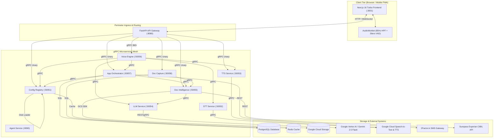
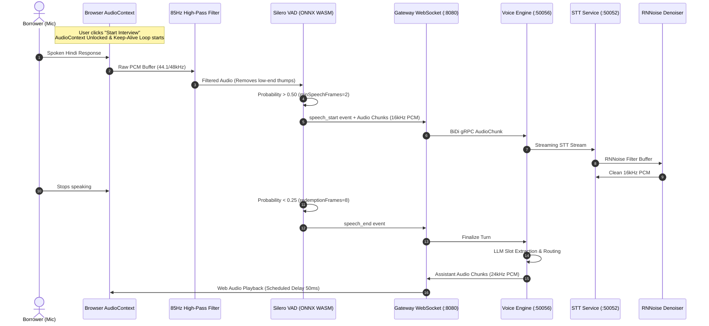
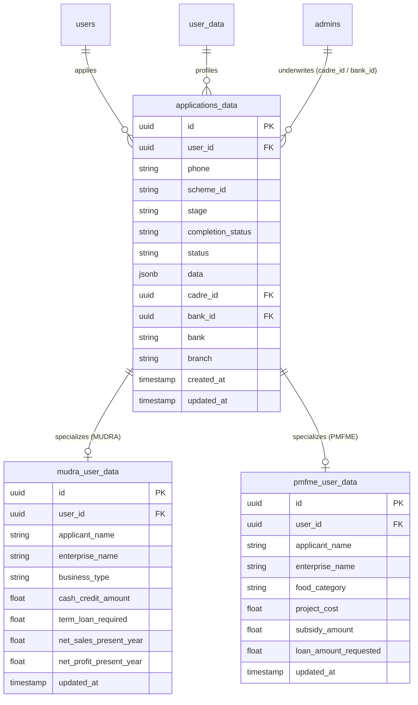

# Chayan AI Services Ecosystem — Knowledge Transfer & Technical Architecture

> **Comprehensive Knowledge Transfer (KT) Specification** covering the end-to-end architecture, communication protocols, microservices, digital signal processing (DSP), dynamic scheme discovery, AST calculation engine, data synchronization, and operational runbooks for the `services/` ecosystem.

---

## Table of Contents

1. [Executive Summary & System Philosophy](#1-executive-summary--system-philosophy)
2. [End-to-End System Topology & Architecture](#2-end-to-end-system-topology--architecture)
3. [Service Catalog & Network Port Matrix](#3-service-catalog--network-port-matrix)
4. [Communication Protocols & API Contracts](#4-communication-protocols--api-contracts)
5. [Deep Dive: Individual Microservices](#5-deep-dive-individual-microservices)
   - [5.1 API Gateway (`services/gateway`)](#51-api-gateway-servicesgateway)
   - [5.2 App Orchestrator (`services/app-orchestrator`)](#52-app-orchestrator-servicesapp-orchestrator)
   - [5.3 Config Registry (`services/config-registry`)](#53-config-registry-servicesconfig-registry)
   - [5.4 Voice Engine (`services/voice-engine`)](#54-voice-engine-servicesvoice-engine)
   - [5.5 Speech-to-Text Service (`services/stt-service`)](#55-speech-to-text-service-servicesstt-service)
   - [5.6 Text-to-Speech Service (`services/tts-service`)](#56-text-to-speech-service-servicestts-service)
   - [5.7 Document Capture Service (`services/doc-capture`)](#57-document-capture-service-servicesdoc-capture)
   - [5.8 Document Intelligence Service (`services/doc-intelligence`)](#58-document-intelligence-service-servicesdoc-intelligence)
   - [5.9 LLM Inference Service (`services/llm-service`)](#59-llm-inference-service-servicesllm-service)
   - [5.10 Autonomous Agent Service (`services/agent-service`)](#510-autonomous-agent-service-servicesagent-service)
   - [5.11 Frontend Applicant Portal (`services/frontend`)](#511-frontend-applicant-portal-servicesfrontend)
6. [Audio DSP & Client-Side Voice Processing Pipeline](#6-audio-dsp--client-side-voice-processing-pipeline)
7. [Dynamic Scheme Discovery & AST Calculation Engine](#7-dynamic-scheme-discovery--ast-calculation-engine)
8. [Database Architecture & Cross-Table Synchronization](#8-database-architecture--cross-table-synchronization)
9. [Edge Cases, Error Handling & Recovery Strategies](#9-edge-cases-error-handling--recovery-strategies)
10. [Local Development, Deployment & Operational Runbook](#10-local-development-deployment--operational-runbook)

---

## 1. Executive Summary & System Philosophy

Chayan AI is an enterprise-grade digital public infrastructure (DPI) platform tailored for hyper-localized, vernacular lending across rural and semi-urban India. The platform automates the end-to-end loan onboarding lifecycle for micro-enterprises applying for government financial schemes such as:
- **Pradhan Mantri MUDRA Yojana (PMMY)**: Shishu (up to ₹50k), Kishore (₹50k–₹5L), and Tarun (₹5L–₹10L) credit facilities.
- **PM Formalisation of Micro food processing Enterprises (PMFME)**: Capital subsidy and working capital for micro-food processing units.
- **Rural Self Employment Training Institutes (RSETI) MUDRA**: Specialized credit linkages for skill-certified rural entrepreneurs.

### Core Architectural Axioms

1. **Protocol Decoupling (REST/WebSocket at Perimeter, gRPC Internally)**:
   External clients communicate exclusively with the API Gateway over HTTP/REST (JSON) and WebSockets (binary audio frames and JSON control messages). All inter-service communication behind the perimeter is strictly powered by **HTTP/2 gRPC with Protobuf serialization**, guaranteeing microsecond serialization latency, strict type validation, and streaming capabilities.
2. **Dynamic Scheme Configuration (Zero-Code New Scheme Ingestion)**:
   No loan scheme rules, questions, interview graphs, financial calculations, or document requirements are hardcoded in application logic. Instead, schemes are declared declaratively in YAML within `config-registry/configs/`. Adding a new loan scheme (e.g., Stand-Up India, PMEGP) requires authoring a configuration file without redeploying backend microservices.
3. **Safe Dynamic Evaluation (AST Sandbox)**:
   Mathematical modeling, financial ratio derivation, and balance-sheet projections are evaluated via a custom Python Abstract Syntax Tree (`ast.NodeVisitor`) sandbox. This eliminates the catastrophic security risks of `eval()` while allowing arbitrary algebraic, conditional, and clamped statistical expressions.
4. **Resilient Vernacular Audio DSP**:
   Given low-bandwidth 4G/3G mobile connectivity and severe acoustic noise in rural environments, audio processing is distributed:
   - **Client Edge**: High-pass filtering (85 Hz cutoff), ONNX WebAssembly Silero Voice Activity Detection (VAD), and AudioContext keepalive synthesis.
   - **Backend Ingress**: Recurrent Neural Network Noise Suppression (RNNoise) stream denoiser operating on 16kHz PCM audio buffers prior to Automatic Speech Recognition (ASR).

---

## 2. End-to-End System Topology & Architecture



---

## 3. Service Catalog & Network Port Matrix

| Service Name | Directory | Primary Role | Ingress Port | Protocol | Upstream Dependencies |
| :--- | :--- | :--- | :--- | :--- | :--- |
| **`frontend`** | `services/frontend` | Next.js 16 Turbo applicant portal | `3001` | HTTP / WS | `gateway` (:8080) |
| **`gateway`** | `services/gateway` | API Gateway, JWT auth, WS bridge | `8080` | HTTP / WS | All gRPC microservices |
| **`config-registry`**| `services/config-registry`| Dynamic scheme YAML schemas & cache | `50051` | gRPC | Redis (optional) |
| **`stt-service`** | `services/stt-service` | RNNoise filter & speech-to-text | `50052` | gRPC | Google Cloud Speech API |
| **`tts-service`** | `services/tts-service` | Text-to-speech synthesis (24kHz) | `50053` | gRPC | Google Cloud TTS (Chirp3) |
| **`llm-service`** | `services/llm-service` | Gemini / Vertex AI inference gateway | `50054` | gRPC | Google Vertex AI / GenAI |
| **`doc-intelligence`**| `services/doc-intelligence`| OCR, vision extraction, CIBIL | `50055` | gRPC | `llm-service`, Surepass, GCS |
| **`voice-engine`** | `services/voice-engine` | BiDi conversational voice orchestrator| `50056` | gRPC | `stt`, `tts`, `llm`, `config-registry`, `app-orchestrator` |
| **`app-orchestrator`**| `services/app-orchestrator`| Lifecycle state, OTP, AST engine, DB | `50057` | gRPC | PostgreSQL, `config-registry`, 2Factor |
| **`doc-capture`** | `services/doc-capture` | Multi-page doc onboarding engine | `50058` | gRPC | `doc-intelligence`, PostgreSQL |
| **`agent-service`** | `services/agent-service` | Autonomous tool-calling agent | `8090` | gRPC / REST | `llm-service`, Gemini GenAI SDK |

---

## 4. Communication Protocols & API Contracts

All inter-service gRPC contracts reside in `services/proto/`. The compilation script `compile_protos.sh` automatically compiles these `.proto` definitions into Python client and server stubs across all services using `grpc_tools.protoc`.

### Key Protobuf Definitions

#### 1. `app_orchestrator.proto` (`chayan.orchestrator`)
- `SendOtp(SendOtpRequest) returns (SendOtpResponse)`: Triggers SMS OTP verification via 2Factor.
- `VerifyOtp(VerifyOtpRequest) returns (VerifyOtpResponse)`: Verifies OTP code, provisions a user session.
- `CreateApplication(CreateAppRequest) returns (Application)`: Initializes an application isolated by `scheme_id` and user.
- `SavePanchayat(SavePanchayatRequest) returns (SavePanchayatResponse)`: Resolves cadre administrative hierarchy, generates formatted application ID `YYYY/MM/{BLOCK}-{SEQ}`.
- `UpsertExtractedData(UpsertDataRequest) returns (UpsertDataResponse)`: Ingests extracted interview and doc fields, triggers AST calculations and DB sync.
- `CalculateFinancials(FinancialCalcRequest) returns (FinancialCalcResponse)`: Runs AST engine to generate derived balance sheet figures.
- `GetExtractedData(AppIdRequest) returns (ExtractedData)`: Returns raw and derived application state.

#### 2. `voice_engine.proto` (`chayan.voice`)
- `StartSession(VoiceSessionRequest) returns (VoiceSessionResponse)`: Configures a conversational session with scheme parameters.
- `ProcessAudioStream(stream AudioChunk) returns (stream VoiceEvent)`: Bi-directional streaming RPC. Transmits client PCM audio chunks and streams back assistant audio frames, interim transcripts, and state transition signals.

#### 3. `config_registry.proto` (`chayan.config`)
- `GetSchemeConfig(SchemeRequest) returns (SchemeConfig)`: Retrieves full parsed configuration.
- `GetInterviewGraph(SchemeRequest) returns (InterviewGraph)`: Delivers conversational nodes, prompt templates, slot targets, and conditional transition edges.
- `GetFinancialRules(SchemeRequest) returns (FinancialRules)`: Exposes financial parameters and dynamic calculation expressions.

#### 4. `doc_capture.proto` (`chayan.doc_capture`)
- `StartSession(StartCaptureRequest) returns (CaptureSessionResponse)`: Inits a document ingestion workflow.
- `ProcessDocument(ProcessDocRequest) returns (ProcessDocResponse)`: Runs document quality gate, OCR classification, and field extraction.

---

## 5. Deep Dive: Individual Microservices

### 5.1 API Gateway (`services/gateway`)
The API Gateway is built on **FastAPI (ASGI)** running under Uvicorn on port `8080`. It serves as the sole perimeter entry point, performing:
1. **REST-to-gRPC Transcoding**: Translates client JSON requests into strongly-typed Protobuf structs and forwards them to backend gRPC servicers via pre-warmed gRPC channels.
2. **WebSocket Voice Ingress (`/ws/voice/{session_id}`)**: Bridges client WebSockets to the `voice-engine` bi-directional gRPC streaming RPC (`ProcessAudioStream`).
3. **Request Correlation (`req_id`)**: The `RequestIDMiddleware` assigns a UUID4 to every incoming request, injects it into client response headers (`X-Request-ID`), and propagates it across all gRPC calls via metadata headers (`('x-request-id', req_id)`).
4. **CORS & Auth**: Handles cross-origin requests from the Next.js frontend and provides lightweight JWT validation while exempting WebSocket handshakes.

### 5.2 App Orchestrator (`services/app-orchestrator`)
The App Orchestrator is the transaction manager and lifecycle brain of the platform. Key subsystems include:

#### A. Administrative Cadre Assignment & Application ID Generation
When a user finishes the registration step (`SavePanchayat`), the orchestrator generates a standardized application identifier:
$$\text{Application ID} = \text{YYYY} / \text{MM} / \text{BLOCK\_NAME} - \text{SEQ}_{001\dots999}$$
It resolves the responsible Level 1 Admin (Cadre) via a multi-tier fallback:
1. **RSETI User Lookup**: If candidate flagged `rseti='yes'`, finds an admin assigned to scheme `rseti_mudra` with role `LVL1`.
2. **Panchayat Lookup**: Queries junction table `admin_panchayats` joining `panchayats` where `UPPER(TRIM(panchayat)) = UPPER(TRIM(:panchayat))`. If unmapped, checks `ANY(admins.villages)`.
3. **Block Fallback**: If no panchayat match (e.g., urban or unmapped blocks), queries `admin_blocks` or block name in `ANY(admins.villages)`.
4. **District Default**: Fallback to district default administrator.

#### B. 2Factor SMS Integration
Sends 4-digit numeric OTPs via `2Factor.in` transactional endpoints:
- Method 1: HTTP POST to `https://2factor.in/API/V1/{API_KEY}/ADDON_SERVICES/SEND/TSMS` with template name `Mudra OTP`.
- Method 2: GET fallback to `https://2factor.in/API/V1/{API_KEY}/SMS/{PHONE}/{OTP}/Mudra+OTP`.
- Local Dev: Fallback logs OTP directly to console if `TWO_FACTOR_API_KEY` is not present.

#### C. Derived Calculations & Database Sync
Whenever data is upserted (`UpsertExtractedData`), the orchestrator:
1. Loads the scheme configuration from `config-registry`.
2. Merges newly received fields with existing database state.
3. Invokes the AST Calculation Engine (`calculations.py`).
4. Persists the output into both the JSON document store (`applications_data.data`) and relational columns (`mudra_user_data` or `pmfme_user_data`).

### 5.3 Config Registry (`services/config-registry`)
Acts as the single source of truth for all loan scheme definitions.
- **Config Storage**: Stored as human-readable YAML files in `config-registry/configs/` (`base-mudra.yaml`, `base-pmfme.yaml`, `rural-voice-test.yaml`).
- **In-Memory & Redis Caching**: Configurations are parsed once upon startup or on-demand, validated against internal schemas, cached in Redis (with in-memory dictionary fallback), and served via gRPC.
- **Graph Transformation**: Converts YAML node dictionaries into protobuf `InterviewGraph` and `GraphNode` structures, attaching localized prompts (`text_templates`), slot filling extraction targets (`targets`), and conditional transition edges.

### 5.4 Voice Engine (`services/voice-engine`)
The Voice Engine manages the interactive spoken dialogue between the borrower and the AI interviewer.
- **GraphWalker State Machine (`graph_walker.py`)**: Traverses the scheme interview graph. Maintains current node, visited history, filled slots, and edge evaluation logic.
- **Turn-Taking Engine (`session.py`)**: Coordinates incoming user speech chunks, triggers speech-to-text, evaluates slot extraction via LLM, formats dynamic localized response templates, and streams TTS audio back to the client.
- **Nudge Generator (`nudge_generator.py`)**: When user silence is detected after a question, fires progressive nudges (subtle prompt reminder $\to$ simplified vernacular rephrasing $\to$ assistance offer).

### 5.5 Speech-to-Text Service (`services/stt-service`)
- **Noise Suppression**: Incoming audio streams are piped through `RNNoiseStreamDenoiser` to eliminate background vehicle, agricultural pump, and domestic background noise without distorting formant frequencies.
- **Engine Backends**:
  - Primary: Google Cloud Speech-to-Text v1/v2 supporting Indian English (`en-IN`), Hindi (`hi-IN`), Marathi (`mr-IN`), Telugu (`te-IN`), and Arabic (`ar-XA`).
  - Stubs: NVIDIA NeMo Conformer-CTC and Faster-Whisper.
- **Sampling & Formatting**: Enforces 16,000 Hz, 16-bit linear PCM mono audio.

### 5.6 Text-to-Speech Service (`services/tts-service`)
- **Voice Synthesis**: Standardized on Google Cloud TTS using High-Definition neural voices:
  - Hindi: `hi-IN-Chirp3-HD-Aoede` or `hi-IN-Neural2-D`
  - English: `en-IN-Neural2-D`
- **Output Standardization**: Strictly generates 24,000 Hz, 1-channel, 16-bit PCM or MP3 audio across all synthesizers.
- **Chunked Streaming (`SynthesizeStream`)**: Splits long paragraphs into sentence boundaries, synthesizing and streaming audio buffers incrementally to minimize Time-to-First-Audio (TTFA) below 600ms.

### 5.7 Document Capture Service (`services/doc-capture`)
A declarative document ingestion workflow manager:
- **Session State Machine**: Manages the linear capture sequence (Aadhaar Front $\to$ Aadhaar Back $\to$ PAN $\to$ Udyam Registration $\to$ Bank Passbook $\to$ Utility Bill $\to$ Machinery Quotation Photos).
- **Quality Gate (`quality_gate.py`)**: Evaluates image sharpness (Laplacian variance), contrast distribution, glare detection, and boundary completeness before invoking expensive OCR.
- **Recovery Engine (`recovery_engine.py`)**: Provides user-friendly voice and text instructions if an image is rejected (e.g., *"Photo is blurry. Please hold steady in good lighting"*).

### 5.8 Document Intelligence Service (`services/doc-intelligence`)
- **Multimodal OCR Extraction**: Pipes uploaded document images to Gemini 2.5 Flash with structured JSON schemas to extract fields (name, father's name, DOB, Aadhaar/PAN number, address, IFSC, bank account number).
- **Surepass Experian Integration (`CheckCibil`)**: Invokes the Surepass credit score API using applicant PAN and mobile number to obtain credit score (0–10 scaled), active tradelines, overdue amounts, and default history.
- **Cloud Storage**: Persists processed document assets into Google Cloud Storage (`augmen-docs` bucket) with secure, time-limited signed URLs.

### 5.9 LLM Inference Service (`services/llm-service`)
- **Provider Abstraction**: Interfaces with Google Cloud Vertex AI and Google AI Studio GenAI SDK.
- **Thinking Mode Control**: Supports Gemini 2.5 Flash thinking configurations (`thinking_budget`), enabling deep reasoning for complex financial validation while disabling thinking for low-latency conversational slot-filling.
- **Streaming & Unary RPCs**: Implements `Generate` (unary) and `GenerateStream` (server streaming) with automatic token usage tracking.

### 5.10 Autonomous Agent Service (`services/agent-service`)
An autonomous task runner powered by Gemini native tool-calling:
- Exposes tools for database querying, document verification, application updates, and status overrides.
- Implements a multi-turn reasoning loop (`AgentSession`) with human-in-the-loop confirmation gates for sensitive actions (e.g., sanctioning or rejecting an application).

### 5.11 Frontend Applicant Portal (`services/frontend`)
Built with **Next.js 16 Turbo (App Router)** and styled with Vanilla CSS:
- `/register`: Phone input, OTP verification via 2Factor, location tree picker (State $\to$ District $\to$ Block $\to$ Panchayat).
- `/capture/[schemeId]`: Interactive camera viewfinder with client-side guidance overlays for capturing mandatory scheme documents.
- `/interview`: Real-time voice interview interface featuring live visualizer, AI avatar playback, automated question navigation, and vernacular transcripts.
- `/dashboard/details`: Comprehensive borrower dossier displaying extracted fields, uploaded documents, financial viability metrics, and review status.

---

## 6. Audio DSP & Client-Side Voice Processing Pipeline

The voice interface operates in real-time over mobile networks, requiring sophisticated Digital Signal Processing (DSP) to prevent latency, echo loops, and clipping.



### Pipeline Key Details

1. **Hardware Wake-Up & Keep-Alive Loop (`voiceHelper.js`)**:
   - **Cold-State Latency**: Mobile browsers enter a dormant audio power state after 2 seconds of silence, causing a 300–800ms lag on subsequent playback.
   - **Keep-Alive Synthesizer**: A continuous looping 1-second audio buffer with imperceptible random noise ($\pm 0.00001$ amplitude) plays in the background, keeping the mobile audio driver permanently active without triggering browser silence-suspension heuristics.
2. **85 Hz High-Pass Filter (HPF)**:
   A client-side BiquadFilter (`type = "highpass"`, `frequency = 85Hz`, `Q = 0.707`) eliminates wind buffeting, microphone handling clicks, and 50/60 Hz mains hum before frames reach the VAD.
3. **Silero VAD in WebAssembly (`audioProcessor.js`)**:
   - Model: Silero VAD ONNX model (~1.5MB) executed via `onnxruntime-web`.
   - Tuned Thresholds:
     - `positiveSpeechThreshold = 0.50`: Speech confirmed after 2 consecutive frames (64ms).
     - `negativeSpeechThreshold = 0.25`: End-of-speech triggered after 8 redemption frames (256ms of silence).
4. **Backend RNNoise Denoiser (`rnnoise_denoiser.py`)**:
   Incoming 16kHz linear PCM buffers are passed through a recurrent neural network trained on over 500 hours of noise profiles to suppress ambient noise prior to ASR.

---

## 7. Dynamic Scheme Discovery & AST Calculation Engine

### 7.1 Dynamic Scheme YAML Architecture
Loan schemes are defined in `config-registry/configs/*.yaml`. Each scheme configuration contains:
- `scheme_id`: Unique identifier (e.g., `base-mudra`, `base-pmfme`).
- `display_name`: Localized scheme title.
- `media_config`: Default TTS voice, STT engine, and language codes.
- `nodes`: Conversational interview state machine nodes.
- `derived_fields`: Declarative algebraic and conditional rules for generating balance sheet projections.
- `admin_portal`: Multi-level approval role workflows and table column mappings.

### 7.2 Safe AST Evaluation Engine (`calculations.py`)
To prevent remote code execution vulnerabilities inherent in `eval()`, the orchestrator evaluates financial formulas via `SafeExpressionEvaluator`, an `ast.NodeVisitor` subclass.

```python
# Architecture of SafeExpressionEvaluator
class SafeExpressionEvaluator(ast.NodeVisitor):
    def __init__(self, context: Dict[str, Any]):
        self.context = context

    def visit_BinOp(self, node: ast.BinOp):
        # Evaluates +, -, *, /, //, %, ** safely with type coercion
        ...

    def visit_Compare(self, node: ast.Compare):
        # Evaluates ==, !=, <, <=, >, >=, in, not in
        ...

    def visit_IfExp(self, node: ast.IfExp):
        # Evaluates ternary expressions: body if test else orelse
        ...

    def visit_Call(self, node: ast.Call):
        # Whitelisted mathematical and statistical functions ONLY
        ...
```

### Whitelisted Function Library

| Function Name | Purpose | Example Expression |
| :--- | :--- | :--- |
| `parse_float(val)` | Safe string/number to float conversion | `parse_float(raw_turnover)` |
| `round_to(val, step)` | Rounds value to nearest multiple of step | `round_to(project_cost, 500)` |
| `round_to_500(val)` | Specialized ₹500 rounding | `round_to_500(daily_sales * 30)` |
| `random_in_range(min, max)`| Generates realistic financial spread | `random_in_range(1.10, 1.25) * net_sales` |
| `clamp_growth(p, b, min, max)`| Enforces bounds on projected revenue growth | `clamp_growth(projected_rev, current_rev, 1.1, 1.2)` |
| `calc_pmfme_subsidy(cost)`| Evaluates 35% capital subsidy (capped at ₹10L)| `calc_pmfme_subsidy(project_cost)` |
| `calc_pmfme_loan_amount(...)`| Computes bank loan net of margin and subsidy | `calc_pmfme_loan_amount(project_cost, own_contrib, subsidy)`|
| `sum_machinery_cost(items)`| Aggregates JSON quotation lists | `sum_machinery_cost(machineries, 200000)` |
| `if_truthy(val, then, else)`| Multi-dialect boolean parser (haan, ho, yes) | `if_truthy(is_married, spouse_pan, 'NA')` |

### Topological Evaluation Sequence
Rules in `derived_fields` are resolved sequentially. Each evaluated field is immediately injected into the active execution context `eval_context[field_name] = val`, enabling downstream formulas to reference upstream calculated outputs (e.g., `project_cost` $\to$ `subsidy_amount` $\to$ `loan_amount_requested`).

---

## 8. Database Architecture & Cross-Table Synchronization

The database is PostgreSQL. Data is synchronized across unified application records and scheme-specific normalized tables.



### Table Roles & Sync Mechanics (`sync_mapping.py` & `server.py`)

1. **`applications_data`**:
   The primary application table. Stores the comprehensive state in the JSONB column `data`, tracking conversational history, raw OCR dumps, administrative notes, and workflow status (`status` = `PENDING`, `APPROVED_BY_LVL_1`, etc.).
2. **`user_data`**:
   Normalized user registry storing base KYC identity, phone number, residential address, and geographic hierarchy (Panchayat, Block, District, State).
3. **Scheme Tables (`mudra_user_data` and `pmfme_user_data`)**:
   Scheme-specific relational projections. When an applicant submits interview answers or document captures, `sync_extracted_data_to_db()`:
   - Queries `information_schema.columns` to validate target schema columns dynamically.
   - Maps incoming field keys using `FIELD_TO_DB_MAP` (for MUDRA) or `PMFME_FIELD_TO_DB_MAP` (for PMFME).
   - Updates the target table while synchronizing corresponding keys into `applications_data.data`.

---

## 9. Edge Cases, Error Handling & Recovery Strategies

| Scenario / Failure Mode | Root Cause | System Recovery Strategy |
| :--- | :--- | :--- |
| **Mobile Audio Hardware Sleep** | Mobile OS suspends `AudioContext` after 2s of silence. | `startKeepAliveLoop()` maintains imperceptible noise ($\pm 1\times 10^{-5}$) buffer, keeping audio drivers awake. |
| **Flaky CDN Script Loading** | WASM/ONNX scripts drop packets on spotty 4G connections. | `loadWithRetry()` implements 3-tier exponential backoff (500ms $\to$ 1000ms $\to$ 2000ms) with global namespace deep validation (`window.vad.MicVAD`). |
| **Acoustic Noise / Motor Hum** | Rural recording near diesel pump or road traffic. | Client 85Hz HPF cuts low-frequency rumble; backend `RNNoise` suppresses non-speech frequencies before ASR processing. |
| **User Silence / Hesitation** | Applicant unsure how to answer question. | `NudgeGenerator` triggers progressive nudges at 6s (vernacular prompt repeat) and 12s (simplified explanation). |
| **Invalid Document Image** | Motion blur, glare, or cropped document borders. | `QualityGate` detects low Laplacian variance (<100) or high glare ratio, triggering immediate voice/visual recapture feedback before running OCR. |
| **AST Mathematical Error** | Missing dependency or division by zero in formula. | `SafeExpressionEvaluator` catches zero division and returns `0.0`; invalid formulas log a warning and fall back to original raw input value without crashing the worker. |
| **Unmapped Panchayat** | New village or district reorganization not in master data. | Orchestrator falls back from Panchayat $\to$ Block Admin $\to$ District Default Admin, logging an unmapped warning. |

---

## 10. Local Development, Deployment & Operational Runbook

### 10.1 Environment Setup
Execute the automated setup script to provision Python virtual environments and install dependencies for all 8 microservices and the Next.js frontend:

```bash
cd /Users/keshavgarg/Documents/augmen/services
bash setup.sh
```

### 10.2 Compiling Protobuf Contracts
Whenever changes are made to `.proto` files in `services/proto/`:

```bash
cd /Users/keshavgarg/Documents/augmen/services
bash compile_protos.sh
```
This distributes compiled `*_pb2.py` and `*_pb2_grpc.py` stubs into `gateway/`, `app-orchestrator/`, `config-registry/`, `doc-capture/`, `doc-intelligence/`, `llm-service/`, `stt-service/`, `tts-service/`, `voice-engine/`, and `agent-service/`.

### 10.3 Starting All Services
Start all 8 backend gRPC microservices, the API Gateway, and the Next.js frontend in separate background processes:

```bash
cd /Users/keshavgarg/Documents/augmen/services
bash start.sh
```
*Startup Sequence Enforcement*:
1. `config-registry` (:50051) & `llm-service` (:50054) & `stt-service` (:50052) & `tts-service` (:50053) start first (no cross-service deps).
2. `voice-engine` (:50056) & `doc-intelligence` (:50055) start next.
3. `app-orchestrator` (:50057) & `doc-capture` (:50058) initialize.
4. `gateway` (:8080) launches.
5. `frontend` (:3001) starts under TurboPack.

### 10.4 Stopping All Services
Cleanly terminate all processes and clear PID files:

```bash
cd /Users/keshavgarg/Documents/augmen/services
bash stop.sh
```

### 10.5 Log Inspection
Logs for all background services are streamed directly to `services/.logs/`:

```bash
# Tail all logs concurrently
tail -f services/.logs/*.log

# Tail specific services
tail -f services/.logs/voice-engine.log
tail -f services/.logs/app-orchestrator.log
tail -f services/.logs/gateway.log
```
